NetBlade is a desktop network toolkit for Windows, macOS and Linux. It shows if a host is reachable, where the path to it loses packets or slows down, what DNS returns, how a web server answers, which ports are open, who owns an address or domain, whether a certificate is valid, and how your network adapters and subnets are set up. No command line is necessary.

NetBlade has these tools:

- **Ping and trace:** a continuous traceroute with loss and latency for each hop.
- **DNS lookup:** queries for one record type, from your system nameserver or a nameserver you choose.
- **IP config:** your adapter configuration, the same data as `ipconfig /all`.
- **curl:** an HTTP request built from a form. It shows the curl command, the response and the time of each phase.
- **Multi-ping:** continuous ping of up to 10 hosts. Each host shows as a green, amber or red tile.
- **nmap:** a port scan with the built-in scanner, or with nmap when it is installed.
- **Subnet calculator:** network details, binary view, subnet split and route summary for IPv4 and IPv6.
- **TLS certificate:** the certificate chain, trust, expiry and accepted TLS versions of a server.
- **Whois:** the owner, range and abuse contact of an IP address, AS number or domain.
- **MAC lookup:** the vendor of one or more MAC addresses.
- **Notepad:** temporary notes in a monospace font. Notes save automatically.
- **Text diff:** two pasted texts side by side, with the different lines, words or characters marked.

NetBlade never needs administrator rights. Every tool works for a normal user.

<picture>
  <source media="(prefers-color-scheme: dark)" srcset="assets/screenshots/ping-and-trace-dark.png">
  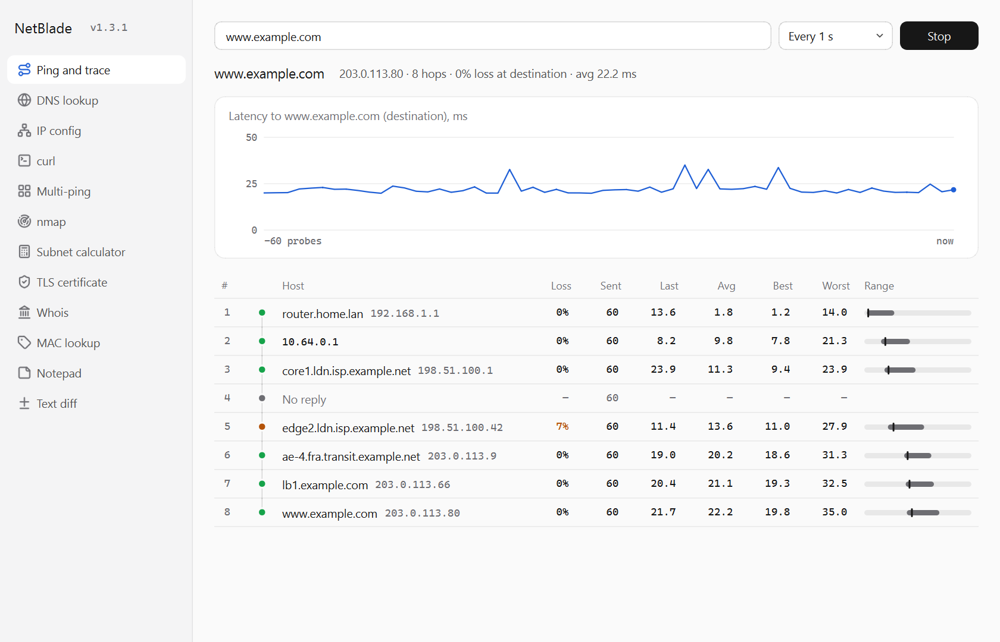
</picture>

## Download

1. Go to the [Releases page](https://github.com/TariqMK/NetBlade/releases).
2. Download the file for your computer:
   - Windows (x64): `NetBlade-vX.Y.Z-windows-x64.exe`
   - macOS (Apple Silicon): `NetBlade-vX.Y.Z-macos-arm64.zip`
   - Linux (x64): `NetBlade-vX.Y.Z-linux-x64.tar.gz`
3. Windows: run the `.exe` file. No installation is necessary.
4. macOS: open the `.zip` file. Move `NetBlade.app` to the Applications folder.
5. Linux: extract the `.tar.gz` file. Run the `NetBlade` file.

**Note:** The builds are not code-signed. Windows SmartScreen can show a warning. Select **More info**, then **Run anyway**.

**Note:** On macOS, the first time you open NetBlade, macOS blocks it. To allow it:

1. Open **System Settings** > **Privacy & Security**.
2. Scroll down to the message about NetBlade.
3. Select **Open Anyway**.

## Use

Select a tool in the sidebar. Or press **Ctrl+1** to **Ctrl+9** and **Ctrl+0**: **Ctrl+1** opens the top tool in the sidebar, **Ctrl+2** the second tool, and so on. **Ctrl+0** opens the tenth tool. Tools after the tenth have no shortcut. The version shows next to the app name at the top of the sidebar. Select the version to check for updates.

The default order is Ping and trace, DNS lookup, IP config, curl, Multi-ping, nmap, Subnet calculator, TLS certificate, Whois, MAC lookup, Notepad and Text diff.

### Change the order of the tools

1. Drag a tool up or down in the sidebar. A line shows where the tool will go.
2. Release the mouse button.

To move a tool with the keyboard, select it, then press **Alt+Up** or **Alt+Down**. You can also right-click a tool and select **Move up** or **Move down**.

To go back to the default order, right-click the sidebar and select **Reset order**.

NetBlade keeps the order when you close it.

**Note:** The **Ctrl+1** to **Ctrl+0** shortcuts follow the new order.

NetBlade follows the light or dark appearance of your system.

### Ping and trace

1. Type a host name or IPv4 address in the target field, for example `1.1.1.1`.
2. Select the probe interval: **Every 0.5 s**, **Every 1 s**, **Every 2 s** or **Every 5 s**. You can change it while the trace runs.
3. Select **Start**, or press Enter.
4. Read the results:
   - The summary line shows the IP address, the number of hops, the loss at the destination and the average latency.
   - The chart shows the latency of the last 60 probes, in ms. A red tick on the baseline is a lost probe.
   - The hop table shows one row for each router on the path. The columns are **Loss**, **Sent**, **Last**, **Avg**, **Best** and **Worst**. Latency is in ms.
   - The dot on the route line shows the loss at that hop. Green is 0%. Amber is less than 20%. Red is 20% or more. Grey is no reply.
   - The **Range** bar shows the best-to-worst latency. The tick shows the average. Hover over the bar to see the values.
5. To chart one hop, select its row in the hop table.
6. Select **Stop** to end the trace.

**Note:** Many routers do not reply to traceroute probes, or reply slowly. A hop with **No reply** or with loss is usually not a problem when the hops after it show 0% loss.

**Note:** Ping and trace uses IPv4 only. A host name resolves to its first IPv4 address.

### DNS lookup

<picture>
  <source media="(prefers-color-scheme: dark)" srcset="assets/screenshots/dns-lookup-dark.png">
  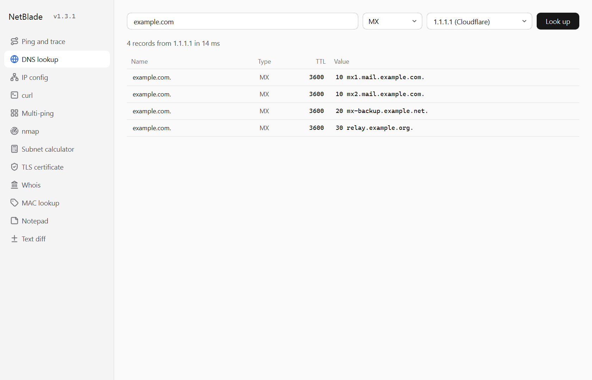
</picture>

1. Type a name in the name field, for example `example.com`.
2. Select the record type: A, AAAA, CNAME, MX, NS, TXT, SOA, SRV, PTR or CAA.
3. Select the nameserver:
   - **System default** uses the nameserver of your computer.
   - **1.1.1.1 (Cloudflare)**, **8.8.8.8 (Google)** or **9.9.9.9 (Quad9)** use that public nameserver.
   - To use a different nameserver, type its IPv4 or IPv6 address in the field.
4. Select **Look up**, or press Enter.
5. Read the results. The summary line shows the number of records, the nameserver that answered and the response time. The table shows **Name**, **Type**, **TTL** and **Value** for each record.

**Note:** For a PTR lookup, type the IP address. NetBlade makes the reverse name for you.

MX records show in preference order. SRV records show in priority order. To copy records, select the rows and press **Ctrl+C**.

### IP config

<picture>
  <source media="(prefers-color-scheme: dark)" srcset="assets/screenshots/ip-config-dark.png">
  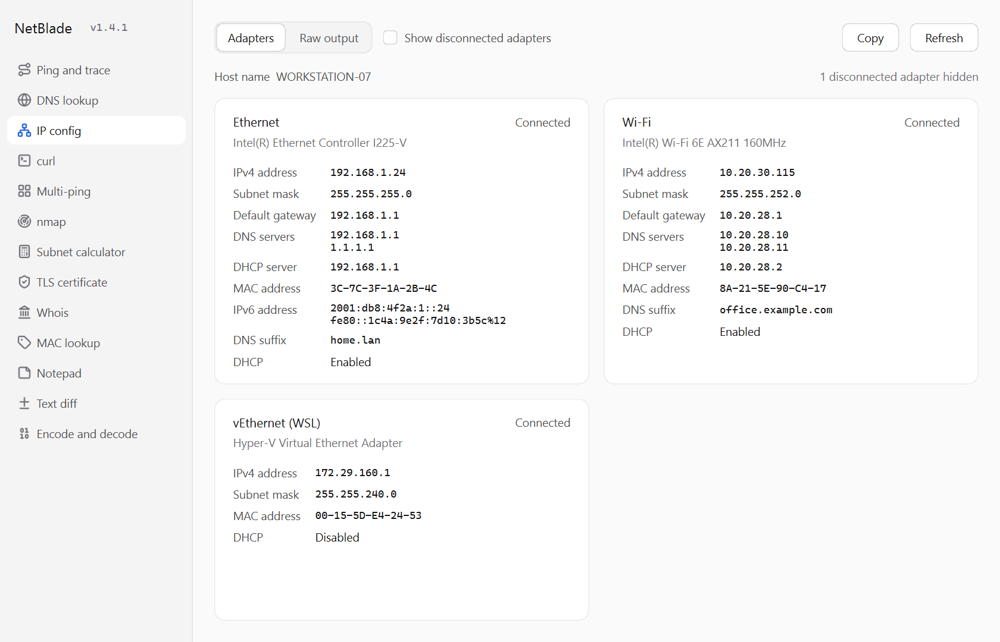
</picture>

The tool reads the configuration when you open it.

1. Select **Adapters** to see one card for each connected adapter. A card shows the IPv4 address, subnet mask, default gateway, DNS servers, DHCP server, MAC address, IPv6 addresses, DNS suffix and DHCP state.
2. To also see disconnected adapters, select **Show disconnected adapters**.
3. Select **Raw output** to see the full command output.
4. Select **Copy** to copy the raw output.
5. Select **Refresh** to read the configuration again.

On Windows, IP config runs `ipconfig /all`. On macOS, it runs `ifconfig`, `route -n get default` and `scutil --dns`. On Linux, it runs `ip addr`, `ip route` and `resolvectl status`. On macOS and Linux, only **Raw output** is available.

**Note:** The **Adapters** view needs Windows in English. In other languages, NetBlade shows **Raw output**.

### curl

<picture>
  <source media="(prefers-color-scheme: dark)" srcset="assets/screenshots/curl-dark.png">
  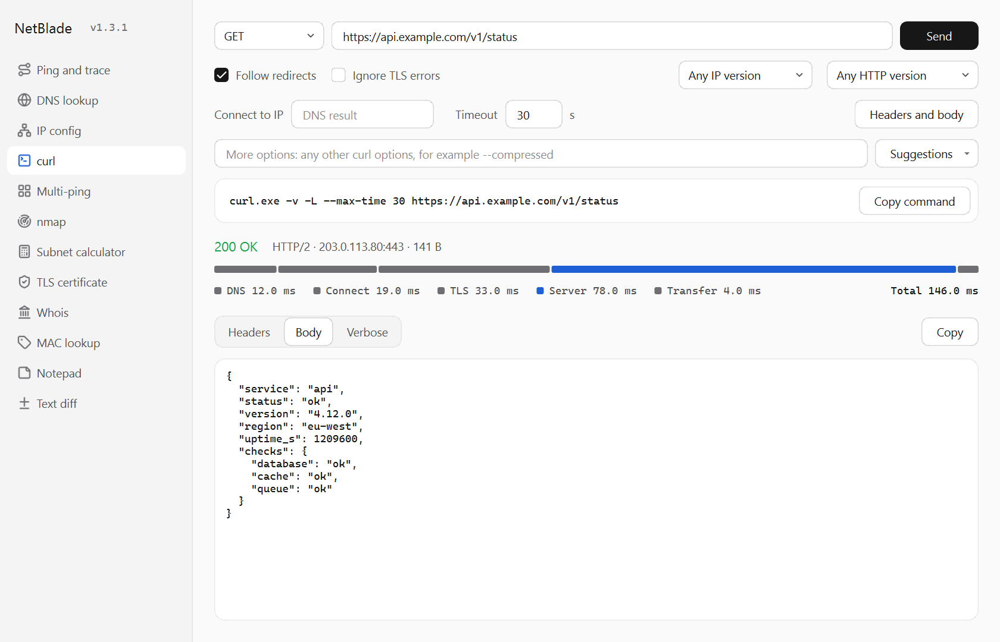
</picture>

The curl tool runs the curl program of your system with the options you set. The command box always shows the exact command. You can copy it and run it in a terminal.

1. Select the method: GET, HEAD, POST, PUT, PATCH, DELETE or OPTIONS.
2. Type the URL, for example `https://example.com`.
3. Set the options you need:
   - **Follow redirects:** follows 3xx redirects (`-L`). This is on by default.
   - **Ignore TLS errors:** accepts self-signed or expired certificates (`-k`).
   - **Any IP version**, **IPv4 only** or **IPv6 only** (`-4`, `-6`).
   - **Any HTTP version**, **HTTP/1.0**, **HTTP/1.1** or **HTTP/2**.
   - **Connect to IP:** connects to this IP address but keeps the host name of the URL (`--resolve`). Use it to test one server behind a load balancer or a CDN.
   - **Timeout:** the maximum time for the request, 1 to 600 s (`--max-time`). The default is 30 s.
4. To send headers or a body, select **Headers and body**. Type one header on each line, for example `Accept: application/json`. Type the body in the right box.
5. To use any other curl option, type it in **More options**. Or select **Suggestions** and select a common option, then change its values.
6. Select **Send**, or press Enter. To stop a request, select **Cancel**.
7. Read the results:
   - The status line shows the status code, the HTTP version, the server IP address and port, the size and the redirects. Green is 2xx. Amber is 4xx. Red is 5xx or a failure.
   - The timing bar shows the time for DNS, Connect, TLS, Server and Transfer, in ms. The slowest phase shows in the accent colour.
   - **Headers** shows the request and response headers. A blank line separates each redirect.
   - **Body** shows the response body. JSON is formatted. Binary content is not shown.
   - **Verbose** shows the full `curl -v` output.
8. Select **Copy** to copy the view. Select **Copy command** to copy the command.

**Note:** Server is the time from the sent request to the first byte of the response. A long Server time usually means a slow application, not a slow network.

**Note:** With redirects, each phase is the total over all requests in the chain.

**Note:** On Windows, the command starts with `curl.exe`. In Windows PowerShell, `curl` runs Invoke-WebRequest, not curl.

### Multi-ping

<picture>
  <source media="(prefers-color-scheme: dark)" srcset="assets/screenshots/multi-ping-dark.png">
  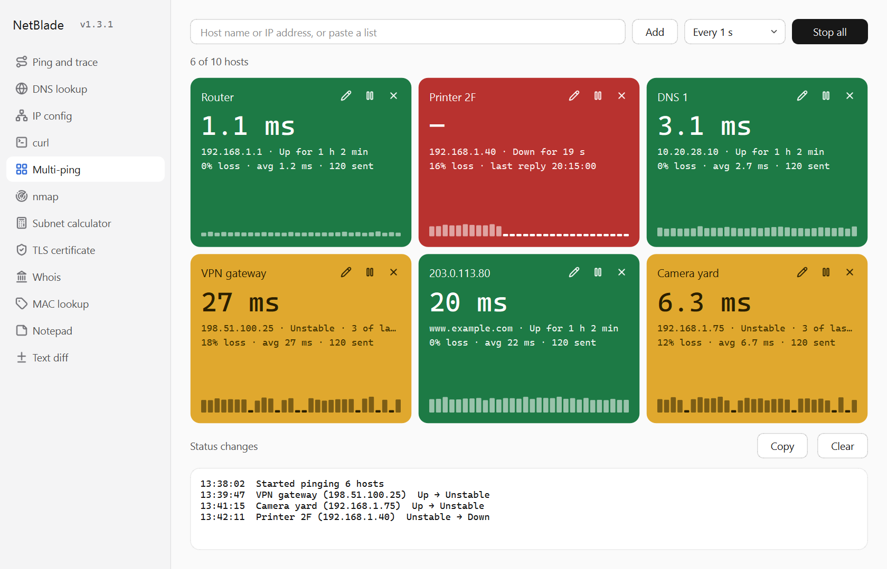
</picture>

Multi-ping pings up to 10 hosts at the same time, without stopping. Each host shows as a tile. The colour of the tile shows the state of the host.

1. Type a host name or IPv4 address in the field, then select **Add**. To add more than one host, paste a list. Separate the hosts with new lines, commas, semicolons or spaces.
2. Select the ping interval: **Every 0.5 s**, **Every 1 s**, **Every 2 s** or **Every 5 s**.
3. Select **Start all**.
4. Read the tiles:
   - **Green (Up):** the last 3 pings replied, and none of the last 10 pings was lost.
   - **Amber (Unstable):** some pings were lost, but not 3 in a row. A host also stays amber for 10 pings after it comes back from Down.
   - **Red (Down):** the last 3 pings were lost, or the name can't be resolved.
   - **Neutral:** not started, or paused.
5. Each tile shows the last reply time, the IP address or DNS name, how long the host has been in its state, the loss, the average time and the number of pings sent. The bars at the bottom show the last 30 pings. A flat mark is a lost ping.
6. To stop or start one host, select the pause or play button on its tile. To remove a host, select the **×** button.
7. Select **Stop all** to stop all pings.

The **Status changes** list shows each change with the time, for example `13:42:11  Printer 2F (192.168.1.40)  Unstable → Down`. It also shows each rename. Select **Copy** to copy the list, or **Clear** to empty it.

**Note:** **Start all** clears the results of all hosts, but keeps the friendly names. The host list and the friendly names are not kept when you close NetBlade.

#### Give a host a friendly name

You can name a host at any time, also while it is pinged. The name shows as the tile title. The IP address always shows below the name.

1. Select the pencil button on the tile. Or double-click the host name, or right-click the tile and select **Rename…**.
2. Type the name, for example `Printer 2F`. A name can have up to 40 characters.
3. Press Enter. To cancel, press Esc.

To remove a friendly name, clear the field and press Enter. Or right-click the tile and select **Remove friendly name**.

### nmap

<picture>
  <source media="(prefers-color-scheme: dark)" srcset="assets/screenshots/nmap-dark.png">
  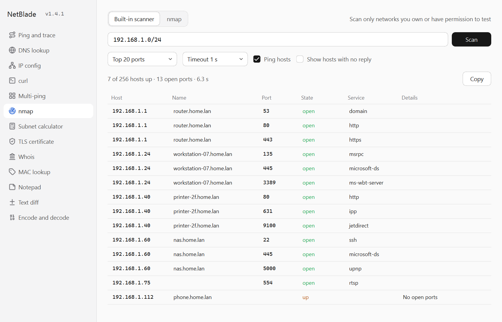
</picture>

The nmap tool scans hosts for open ports. It has two modes: **Built-in scanner** and **nmap**.

**Caution:** Scan only networks that you own or have permission to test.

Type the targets in the target field. You can use host names, IPv4 addresses, networks such as `192.168.1.0/24`, and ranges such as `192.168.1.10-50` or `10.0.0.1-10.0.0.20`. Separate targets with spaces or commas.

#### Built-in scanner

The built-in scanner needs no other software and no administrator rights. It tries a TCP connection to each port, and it can ping each host.

1. Select the ports: **Top 20 ports**, **Top 100 ports** (the same list as `nmap -F`), **Web ports**, **Windows ports** or **Custom ports**. For custom ports, type a list such as `22,80,443,8000-8100`.
2. Select the timeout: **Timeout 0.5 s**, **Timeout 1 s** or **Timeout 2 s**.
3. Keep **Ping hosts** selected to find hosts that answer ping but have no open port.
4. Select **Show hosts with no reply** to also list hosts that did not answer.
5. Select **Scan**, or press Enter. To stop the scan, select **Cancel**.

The built-in scanner scans up to 1,024 hosts at a time, for example a /22 network.

#### nmap mode

nmap mode runs nmap with the options you set. The command box shows the exact command. You can copy it and run it in a terminal. NetBlade always runs nmap with `--unprivileged`, so nmap never needs administrator rights.

**Note:** NetBlade does not include nmap, because the nmap licence does not allow it. Install nmap from [nmap.org](https://nmap.org/download.html), then select **Check again**. On Windows, the nmap installer also installs Npcap.

1. Select the scan type: **TCP connect scan (-sT)** or **Ping sweep only (-sn)**.
2. Select the ports: **Top 1000 ports**, **Top 100 ports (-F)**, **All ports (-p-)** or **Custom ports**.
3. Select the timing: **Polite (-T2)**, **Normal (-T3)**, **Aggressive (-T4)** or **Insane (-T5)**. The default is **Aggressive (-T4)**.
4. Select the options you need: **Service versions (-sV)**, **Default scripts (-sC)** and **Skip host discovery (-Pn)**.
5. To use any other nmap option, type it in **More options**. Or select **Suggestions** and select a common option.
6. Select **Scan**. To stop the scan, select **Cancel**.

**Note:** SYN scans, UDP scans and OS detection are not available, because they need administrator rights. Large networks and service detection can take several minutes.

#### Results

The results table shows one row for each open port: **Host**, **Name**, **Port**, **State**, **Service** and **Details**. A host that is up with no open ports gets one row. In nmap mode, **Details** shows the product and version, the script output, and the MAC address and vendor when nmap finds them. Select **nmap output** to see the full nmap output.

To copy results, select rows and press **Ctrl+C**, or select **Copy** to copy all rows.

### Subnet calculator

<picture>
  <source media="(prefers-color-scheme: dark)" srcset="assets/screenshots/subnet-calculator-dark.png">
  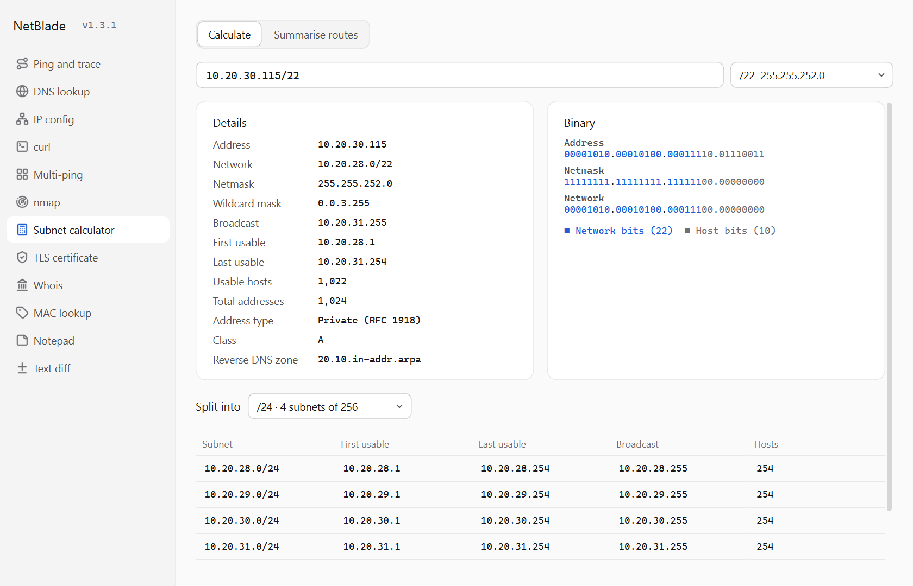
</picture>

1. Type an address with a prefix length or a mask. For example: `192.168.1.10/24`, `10.0.0.1 255.255.255.0` or `2001:db8::1/64`.
2. To change the prefix length, select a value in the prefix list. The list shows the mask (IPv4) or the number of addresses (IPv6).
3. Read the **Details** card:
   - IPv4: address, network, netmask, wildcard mask, broadcast, first and last usable address, usable hosts, total addresses, address type, class and reverse DNS zone.
   - IPv6: address, expanded address, network, prefix length, first and last address, number of addresses, address type and reverse DNS zone.
4. Read the **Binary** card. Network bits show in the accent colour. Host bits show in grey.
5. To split the network, select a prefix in **Split into**. The table shows each subnet with its first and last usable address, broadcast address and number of hosts.

**Note:** A /31 network has 2 usable addresses (point-to-point links, RFC 3021). A /32 network has 1. IPv6 has no broadcast address, so all addresses are usable.

**Note:** The split table shows the first 1,024 subnets.

#### Summarise routes

1. Select **Summarise routes** at the top of the Subnet calculator.
2. Paste the networks or addresses, one per line or separated by commas.
3. Read the **Summary**:
   - **Exact summary:** the fewest routes that cover your list and nothing else.
   - **Single covering route:** the one route that covers all of your list, and how many other addresses it also covers.
4. Select **Copy summary** to copy the exact summary.

**Caution:** When most of the single covering route is outside your list, NetBlade shows a caution. Use the exact summary in that case.

**Note:** An entry with host bits set, for example `10.1.6.7/24`, counts as its network, `10.1.6.0/24`. Entries that are not networks or addresses are skipped. A note shows both.

### TLS certificate

<picture>
  <source media="(prefers-color-scheme: dark)" srcset="assets/screenshots/tls-certificate-dark.png">
  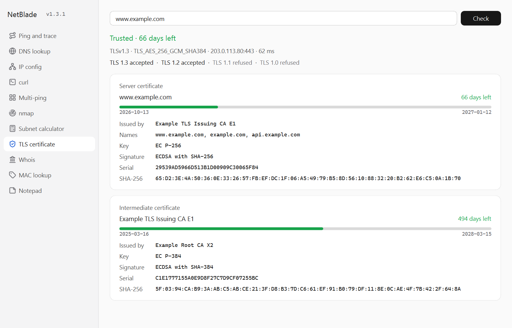
</picture>

1. Type a server, for example `example.com`, `example.com:8443` or `https://example.com`. The default port is 443.
2. Select **Check**, or press Enter.
3. Read the result line:
   - Green: the certificate is trusted, with the days left.
   - Amber: the certificate is trusted but expires in 30 days or less.
   - Red: the certificate has expired, is not yet valid, is not for this host name, is self-signed, or is not trusted by this computer. The reason from this computer shows below.
4. Read the connection line: the TLS version, the cipher, the server IP address and port, and the time.
5. Read the TLS versions: each of TLS 1.3, 1.2, 1.1 and 1.0 shows as accepted or refused. TLS 1.1 and 1.0 show as outdated when the server accepts them.
6. Read the certificate cards, one for each certificate in the chain. Each card shows the validity period as a bar, the issuer, the key, the signature, the serial number and the SHA-256 fingerprint. The server certificate also shows its names.

**Note:** "Trusted" means trusted by this computer. NetBlade uses the same check as the operating system, as a browser does.

### Whois

<picture>
  <source media="(prefers-color-scheme: dark)" srcset="assets/screenshots/whois-dark.png">
  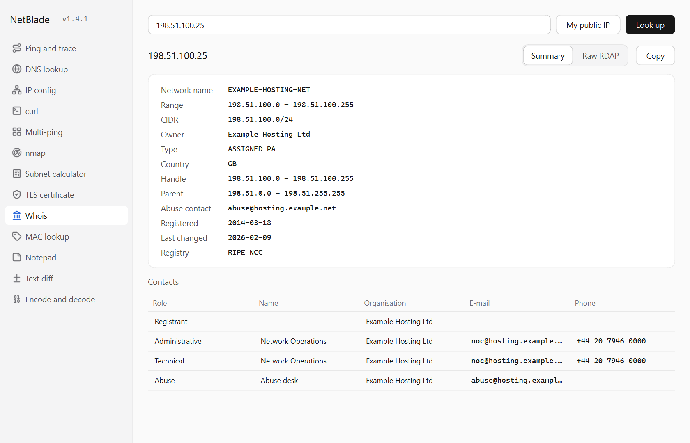
</picture>

Whois uses RDAP, the replacement for the whois protocol. NetBlade finds the registry that holds the record in the IANA directory, then asks that registry.

1. Type an IP address, a network, an AS number or a domain. For example: `8.8.8.8`, `185.199.108.0/22`, `AS13335` or `example.com`. A URL or an e-mail address also works.
2. Select **Look up**, or press Enter. To look up your own public IP address, select **My public IP**.
3. Read the details:
   - IP address or network: network name, range, CIDR, owner, type, country and abuse contact.
   - AS number: name, owner, country and abuse contact.
   - Domain: registrar, owner, status, name servers, DNSSEC and expiry date with the days left.
4. Read the **Contacts** table: role, name, organisation, e-mail and phone.
5. Select **Raw RDAP** to see the full answer from the registry. Select **Copy** to copy the view.

**Note:** For a name such as `www.shop.example.com`, NetBlade looks up the registered domain, `example.com`.

**Note:** **My public IP** asks api.ipify.org for your public IP address.

### MAC lookup

<picture>
  <source media="(prefers-color-scheme: dark)" srcset="assets/screenshots/mac-lookup-dark.png">
  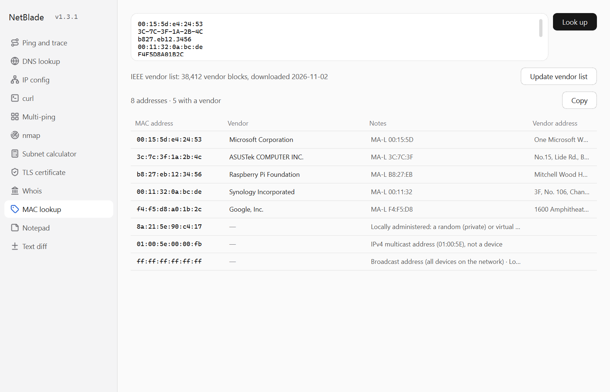
</picture>

MAC lookup finds the vendor of a network device from its MAC address. It uses the IEEE vendor list.

1. The first time, select **Download vendor list**. The list is about 5 MB. After the download, lookups work offline. To get the newest list later, select **Update vendor list**.
2. Paste one or more MAC addresses, one per line or separated by commas. Any format works, for example `00:15:5d:e4:24:53`, `00-15-5D-E4-24-53`, `0015.5de4.2453` or the prefix `00155D`.
3. Select **Look up**, or press **Ctrl+Enter**.
4. Read the table: the MAC address, the vendor, notes and the vendor address. With one MAC address, NetBlade also shows it in colon, hyphen, bare and Cisco formats.

NetBlade explains MAC addresses that have no vendor:

- **Locally administered:** a random (private) address, as phones and laptops use on Wi-Fi, or a virtual address.
- **Multicast** and **broadcast** addresses: these do not belong to one device.

To copy rows, select them and press **Ctrl+C**, or select **Copy** to copy all rows.

### Notepad

<picture>
  <source media="(prefers-color-scheme: dark)" srcset="assets/screenshots/notepad-dark.png">
  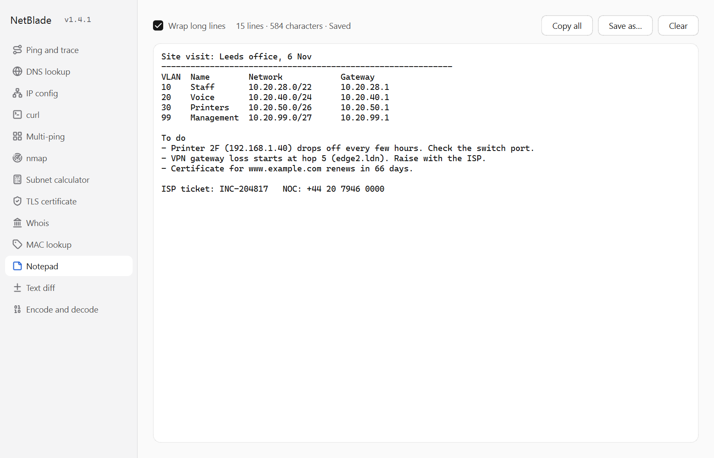
</picture>

The Notepad keeps temporary notes in a monospace font, so columns of addresses and command output line up.

1. Type or paste your notes. NetBlade saves them automatically, shortly after you stop typing.
2. Select **Wrap long lines** to fit long lines to the window. Clear it to scroll long lines sideways.
3. Select **Copy all** to copy the notes, or **Save as…** to save a copy as a text file.
4. To delete all notes, select **Clear**, then **Discard**.

**Caution:** **Clear** deletes the notes and can't be undone.

NetBlade keeps the notes when you close it. They are stored in your user folder.

### Text diff

<picture>
  <source media="(prefers-color-scheme: dark)" srcset="assets/screenshots/text-diff-dark.png">
  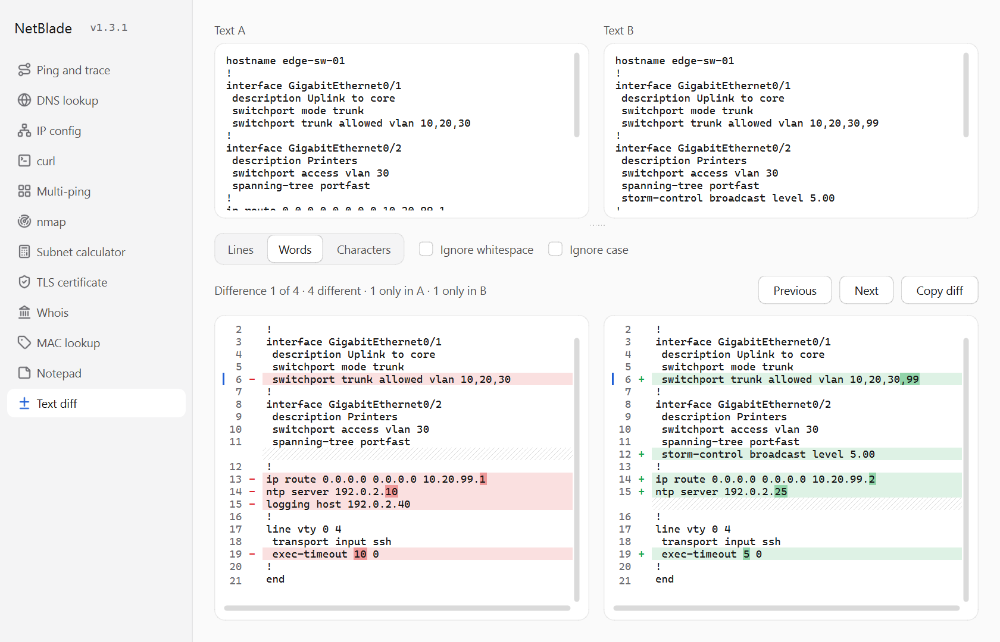
</picture>

Text diff compares two pasted texts, for example two device configurations. You do not need to know which text is newer. The comparison updates shortly after you stop typing.

1. Paste one text in **Text A**.
2. Paste the other text in **Text B**.
3. Select how closely to compare lines that are different:
   - **Lines:** marks the full line only.
   - **Words:** also marks the different words and numbers. This is the default.
   - **Characters:** also marks the different characters.
4. To skip differences that do not matter, select **Ignore whitespace** or **Ignore case**.
5. Select **Next** or **Previous** to move through the differences. The line above the results shows the current difference and the number of lines that are different, only in A and only in B.
6. Select **Copy diff** to copy the differences in unified diff format. Text A lines start with `-` and Text B lines start with `+`.

Text that is different or only in Text A is red and has a `-` marker. Text that is different or only in Text B is green and has a `+` marker. The colours and markers show which text a line is in. They do not show which text is newer. A hatched row shows that the other text has a line here and this text has none. If you copy from the results, the hatched rows are left out.

**Note:** NetBlade does not save the text. The text is gone when you close NetBlade.

### Check for updates

NetBlade checks for updates only when you ask. It never downloads or installs anything.

1. Select the version next to the app name at the top of the sidebar, for example **v1.3.0**. To use the keyboard, press **Tab** until the version is selected, then press **Space**.
2. Wait while the version shows **checking…**. The check takes a few seconds at most.
3. Read the result:
   - **NetBlade is up to date.** You have the latest release.
   - **NetBlade vX.Y.Z is available.** Select **Show Details…** to read what changed. Select **Open release page** to download the new version from GitHub.
   - If the check fails, a message tells you why, for example no internet connection.

When a newer release is found, the version stays in the accent colour until you restart NetBlade.

**Note:** GitHub allows about 60 checks per hour from one network. If you reach the limit, try again an hour later.

## Known limitations

- Ping and trace and Multi-ping use IPv4 only.
- On Linux, Ping and trace needs unprivileged ICMP. Some distributions block it. If the tool shows an ICMP error, ask your administrator to allow your group in `net.ipv4.ping_group_range`.
- Ping and trace and Multi-ping on macOS and Linux are not yet tested on real systems.
- The curl tool needs curl on the system. Windows 10 and later and macOS include it. On Linux, install the `curl` package if it is missing.
- The curl tool shows the first 1 MB of a body.
- The copied curl command uses double quotes on Windows. In PowerShell, a value that contains `"` or `$` can need changes.
- The built-in scanner scans TCP only, IPv4 only, and up to 1,024 hosts at a time. It does not detect versions or operating systems.
- nmap mode needs nmap installed on the system. nmap mode is not yet tested with a real nmap installation.
- The TLS certificate tool does not support STARTTLS, for example on mail ports 25 and 587.
- Some country domains have no RDAP service. Whois then tells you to use the registry's website.
- MAC lookup needs the IEEE vendor list, which you download once.
- Text diff compares up to 20,000 lines per text. Long lines scroll sideways and do not wrap.
- Text diff marks words and characters only in lines up to 2,000 characters. A very large block of different lines shows as lines only in Text A and lines only in Text B, with no inner marks. The line above the results tells you when this occurs.

## Run From Source

Requires Python 3.13 or later.

1. Clone the repository.
2. Create a virtual environment and install NetBlade with the development tools:

   ```bash
   python -m venv .venv
   ```

   ```bash
   .venv/Scripts/pip install -e ".[dev]"
   ```

   On macOS and Linux, use `.venv/bin/pip`.
3. Start the app:

   ```bash
   python -m netblade
   ```

A source run shows the development version `v0.0.0.dev0`. **Check for updates** then reports a development build and names the latest release.

## Run Tests

```bash
pytest
```

The tests send no network traffic. The traceroute tests use a simulated path. The curl tests run curl on a local file and on a closed local port. The port scan test scans a port that the test opens on this computer. The nmap tests use sample nmap output, so nmap is not necessary. The TLS tests start a TLS server on this computer. The Whois and MAC lookup tests use sample registry answers and a sample vendor list.

Check code style with:

```bash
ruff check .
```

## Update the Screenshots

The README screenshots are in `assets/screenshots/`, in a light and a dark version. To make them again from the current source:

```bash
python assets/make_screenshots.py
```

The script fills each tool with sample data and saves 24 PNG files. It sends no network traffic and does not read your adapters, notes or settings. The sidebar shows the newest release tag.

## Creating a Release

Releases are made by the **Release** workflow in GitHub Actions. The workflow does not commit or push to any branch. It creates only a tag and a GitHub release.

1. On GitHub, open the **Actions** tab.
2. Select **Release**.
3. Select **Run workflow**. Keep the branch set to `main`.
4. Set **Draft or public release**:
   - `draft`: creates a draft release. Only you can see it. Publish it later on the Releases page.
   - `public`: creates a published release.
5. Set **Version bump**:
   - `patch`: v1.2.3 to v1.2.4. For fixes.
   - `minor`: v1.2.3 to v1.3.0. For new features.
   - `major`: v1.2.3 to v2.0.0. For large changes.
6. Select **Run workflow**.

The workflow does these steps:

1. Finds the highest existing version in the git tags and GitHub releases, including drafts, then applies the bump.
2. Runs the lint check and the tests. If they fail, nothing is built.
3. Builds NetBlade for Windows x64, macOS Apple Silicon and Linux x64. The version is applied on the build machine only.
4. Starts each build without a display. The check fails if the build does not run, shows the wrong version, or is missing the DNS record modules, the Qt SVG image plugin or the certificate libraries.
5. Tags the built commit and creates the release, with the three files attached and generated release notes.

**Note:** No secrets are necessary. The workflow uses the built-in GitHub token.
